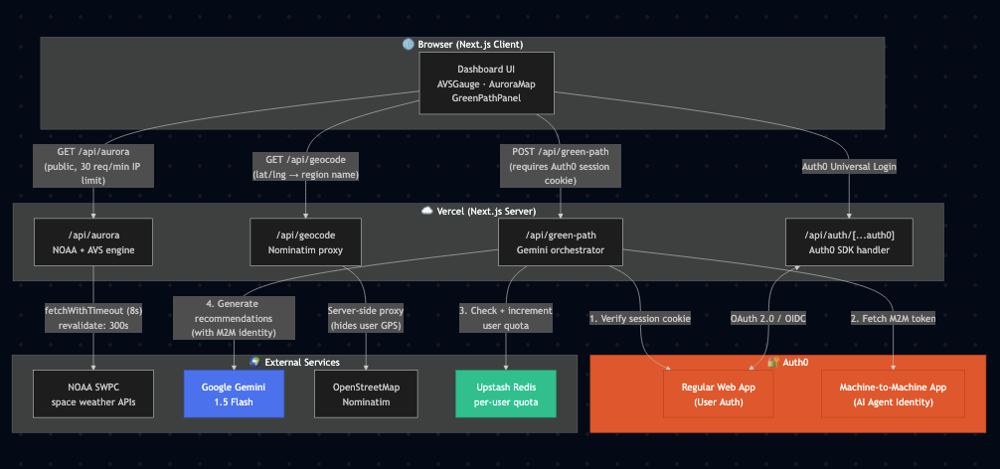

# AuroraPath 🌌

> **Sustainable Aurora Viewing — Earth Day Hackathon 2026**
>
> A real-time, carbon-optimized dashboard for aurora borealis sightings.
> Built for the [dev.to Earth Day Weekend Challenge](https://dev.to/challenges/weekend-2026-04-16).

[](https://vercel.com/new/clone?repository-url=https://github.com/klee1611/AuroraPath)

---

## 🌍 What Is AuroraPath?

AuroraPath connects people with Earth's most spectacular natural phenomenon — the aurora borealis — while promoting sustainable travel. Instead of jumping in a car and driving to a dark-sky spot, AuroraPath shows you the best eco-friendly routes: public transit, carpooling, and low-carbon options, each with real CO₂ savings so you can chase the lights and tread lightly on the planet.

**AuroraPath** combines live NOAA space weather data with Google Gemini AI to help you:

1. **Track real-time aurora activity** — NOAA's OVATION aurora probability, G/R/S-scale meters, solar wind speed
2. **See where auroras are visible** — Interactive map with latitude visibility bands that update with geomagnetic conditions
3. **Find sustainable viewing routes** — AI-generated "Green Path" recommendations with carbon savings, public transit options, and dark-sky ratings

---

## 🎬 Demo

<video src="https://github.com/klee1611/AuroraPath/raw/main/public/Aurora_Path_User_Guide.mp4" controls width="100%"></video>

> Can't see the video? [Download it here](https://github.com/klee1611/AuroraPath/raw/main/public/Aurora_Path_User_Guide.mp4).

---

## 🧬 Aurora Chance

The headline number is **NOAA SWPC's own aurora forecast**: the probability of visible aurora
from the [OVATION Prime 30-minute forecast](https://www.spaceweather.gov/products/aurora-30-minute-forecast),
read straight off its global 1° grid. AuroraPath does not model the aurora itself.

| Situation | Number shown |
|-----------|--------------|
| Location known | OVATION probability at your grid cell |
| No location yet | Highest OVATION probability anywhere in the Northern Hemisphere |
| Green Path gate | Highest OVATION probability within 300 km of you (the radius Green Path searches), so you are not blocked when the aurora is within travelling distance but not overhead |
| OVATION feed down | No number (`null`). Green Path returns 503 instead of guessing |

The forecast is valid ~30–90 minutes ahead of observation and refreshes every minute.
Implemented in [`lib/vscore.ts`](lib/vscore.ts); the API field is still named `avs` for
compatibility.

Note that OVATION is the probability of aurora **overhead** at a point. NOAA notes that with a
clear view of the poleward horizon you can sometimes see aurora up to ~1000 km away, so a
low number at your exact location does not rule out a horizon display.

### Bands

| Chance | Level | Meaning |
|--------|-------|---------|
| 80–100% | 🌌 Excellent | Very likely overhead |
| 60–79% | ✨ High | Likely overhead |
| 35–59% | 🌠 Moderate | Reasonable chance |
| 10–34% | 🌃 Low | Faint or occasional; SWPC's map starts shading at 10% |
| 0–9% | 🌙 None | Unlikely |

### Why not our own score?

An earlier version blended hemispheric power, the Newell solar wind coupling function and Kp
into a custom 0–100 score with a dipole-based oval estimate. It was a reasonable approximation,
but OVATION Prime is the operational model NOAA builds from those same inputs, so using its
output directly is more reliable and easier to explain. The Kp and hemispheric power feeds
that only fed the old score are no longer fetched.

### Data sources

All from [NOAA SWPC](https://services.swpc.noaa.gov/), no API key required:

| Feed | Endpoint |
|------|----------|
| OVATION aurora probability (headline number) | [`json/ovation_aurora_latest.json`](https://services.swpc.noaa.gov/json/ovation_aurora_latest.json) |
| Solar wind + IMF (propagated to the bow shock) | [`products/geospace/propagated-solar-wind-1-hour.json`](https://services.swpc.noaa.gov/products/geospace/propagated-solar-wind-1-hour.json) |
| G/R/S scales + forecasts | [`products/noaa-scales.json`](https://services.swpc.noaa.gov/products/noaa-scales.json) |

### References

- NOAA SWPC, [*Aurora – 30 Minute Forecast*](https://www.spaceweather.gov/products/aurora-30-minute-forecast)
  — the OVATION Prime operational product behind the headline number.
- Newell, P. T., Sotirelis, T., & Wing, S. (2014). *OVATION Prime-2013: Extension of auroral
  precipitation model to higher disturbance levels.* Space Weather, 12, 368–379.
  [doi:10.1002/2014SW001056](https://doi.org/10.1002/2014SW001056)
- NOAA SWPC, [*Tips on Viewing the Aurora*](https://www.spaceweather.gov/content/tips-viewing-aurora)
  — the ~1000 km horizon reach.

---

## 🏗️ Architecture



The system uses a two-layer identity model:
- **Regular Web App** (Auth0) — authenticates end users via Universal Login
- **Machine-to-Machine App** (Auth0) — gives the Gemini AI agent a managed, auditable identity separate from any user

Key data flows:
- `GET /api/aurora` — public endpoint, NOAA ingestion + OVATION probability lookup, 30 req/min IP rate limit.
  Optional `?lat=&lng=` reads the probability at that location; coordinates are rounded to 0.1° by the
  client before being sent
- `GET /api/geocode` — server-side Nominatim proxy (hides user GPS coordinates from third parties)
- `POST /api/green-path` — requires Auth0 session cookie; verifies identity, checks/increments Upstash Redis quota, calls Gemini with M2M token

---

## 🔧 Tech Stack

| | |
|---|---|
| Framework | Next.js 14 (App Router) |
| Language | TypeScript |
| Styling | Tailwind CSS |
| Map | react-leaflet + Stadia Maps |
| Charts | Recharts |
| AI | Google Gemini 3.1 Flash |
| Auth | Auth0 (SPA + M2M) |
| Cache / Quota | Upstash Redis |
| Data | NOAA Space Weather Prediction Center |
| Deploy | Vercel |

---

## 🚀 Setup

### 1. Clone & Install

```bash
git clone https://github.com/klee1611/AuroraPath.git
cd AuroraPath
npm install
```

### 2. Configure Environment

```bash
cp .env.example .env.local
```

Fill in `.env.local`:

| Variable | Where to get it |
|----------|----------------|
| `AUTH0_SECRET` | Run: `openssl rand -hex 32` |
| `AUTH0_BASE_URL` | Your app URL (e.g. `http://localhost:3000`) |
| `AUTH0_ISSUER_BASE_URL` | Your Auth0 domain (e.g. `https://dev-xxx.auth0.com`) |
| `AUTH0_CLIENT_ID` | Auth0 → Applications → Regular Web App |
| `AUTH0_CLIENT_SECRET` | Auth0 → Applications → Regular Web App |
| `AUTH0_M2M_CLIENT_ID` | Auth0 → Applications → Machine to Machine |
| `AUTH0_M2M_CLIENT_SECRET` | Auth0 → Applications → Machine to Machine |
| `AUTH0_M2M_AUDIENCE` | `https://YOUR_DOMAIN.auth0.com/api/v2/` |
| `GEMINI_API_KEY` | [Google AI Studio](https://aistudio.google.com/app/apikey) |
| `UPSTASH_REDIS_REST_URL` | [Upstash console](https://console.upstash.com) → Redis → REST API |
| `UPSTASH_REDIS_REST_TOKEN` | [Upstash console](https://console.upstash.com) → Redis → REST API |
| `DAILY_GEMINI_LIMIT` | Max AI calls per user per day (default: `5`) |

> **Upstash is optional in development.** If not set, an in-memory fallback is used automatically.

### 3. Auth0 Setup

1. Create a **Regular Web Application** in Auth0
2. Set **Allowed Callback URLs**: `http://localhost:3000/api/auth/callback`
3. Set **Allowed Logout URLs**: `http://localhost:3000`
4. Create a **Machine to Machine** application and authorize the Management API

### 4. Run

```bash
npm run dev
```

Open [http://localhost:3000](http://localhost:3000)

---

## 📦 Deploy to Vercel

```bash
npx vercel --prod
```

Add all `.env.local` variables in Vercel → Project Settings → Environment Variables.

Update Auth0 callback/logout URLs to your Vercel domain.

---

*Built with 💚 for Earth Day 2026*
